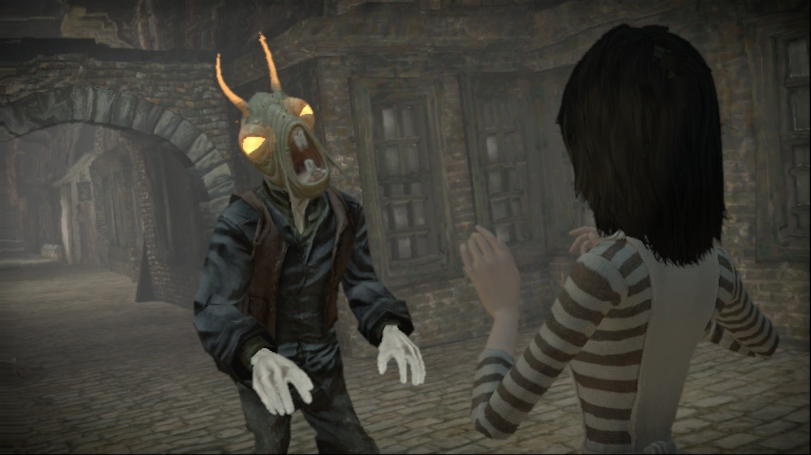
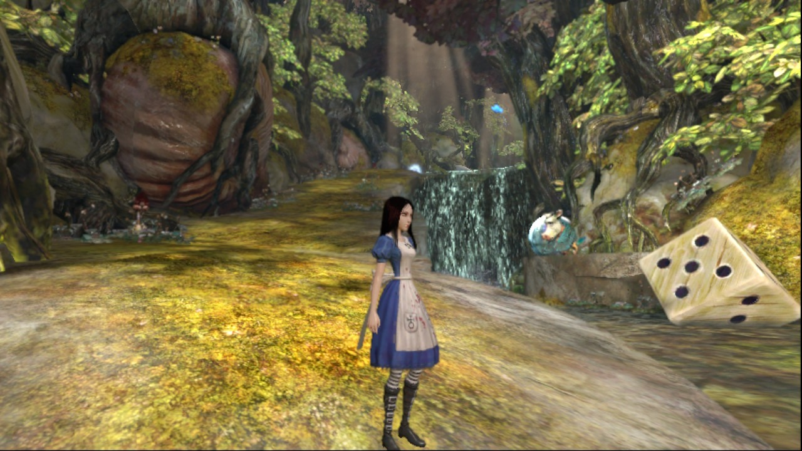
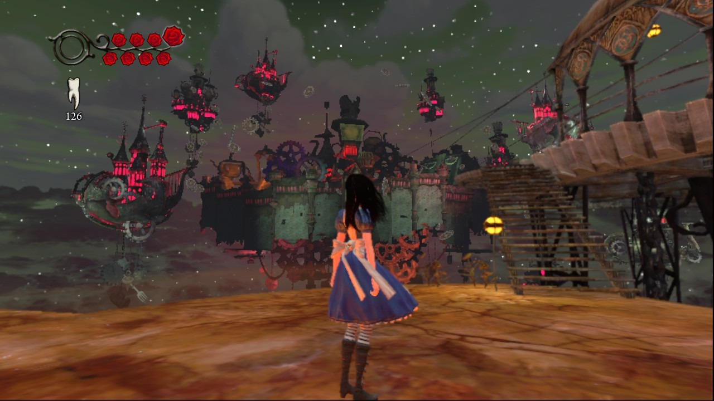
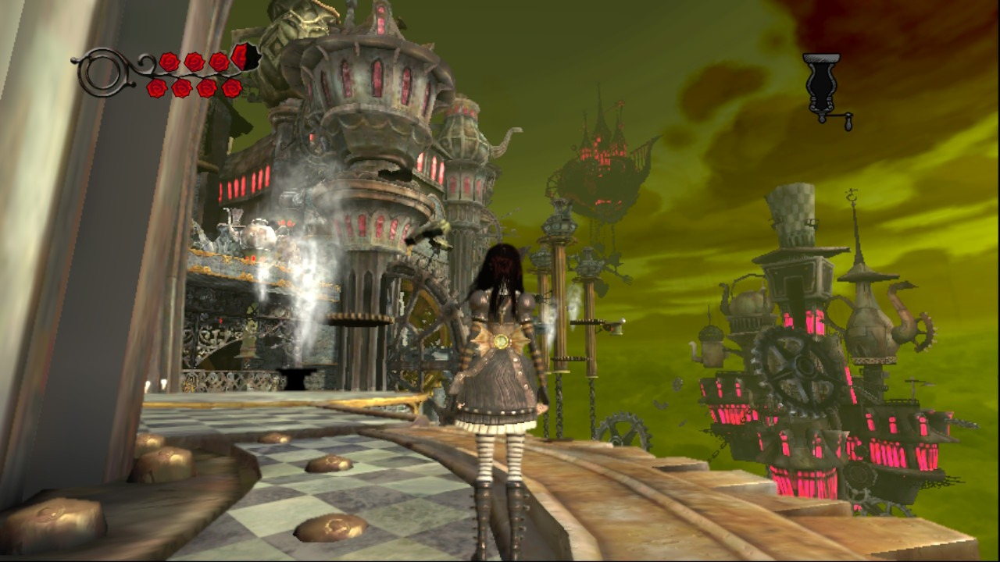

# Alice: Madness Returns Nintendo Switch Port

An unofficial, fan-made port of the Xbox 360 game **Alice: Madness Returns** to the **Nintendo Switch**,
made by static recompilation with [ReXGlue](https://github.com/rexglue/rexglue-sdk). It began from
[mhnwis-nx](https://github.com/adumah/mhnwis-nx); its current ReXGlue SDK, Renut renderer, deko3d backend,
Plume and XenosRecomp dependencies are vendored in this repository from the newer
[Renut NX Ultimate base](https://github.com/ChanseyIsTheBest/renut_nx_ultimate_base).

> [!IMPORTANT]
> **This repository contains no game.** No game files, no game code (translated or not), no shaders, no assets and no
> ready-made NRO. **You need your own copy of the game** (the Xbox 360 disc, dumped by you) and you build the port from
> it on your own computer. See [Disclaimer](#disclaimer).

> [!WARNING]
> **Beta.** The entire game is playable on a real Switch, but the port is not finished: some textures and effects are
> drawn wrong (see [Known issues](#known-issues)), and with the [overclock](#overclock) turned on it runs at **about
> 29.5 fps on average** (a 30 fps cap, with dips to about 21 in the busiest scenes). At the stock clocks (the default)
> it is much slower in gameplay. Unreal Engine 3 is hard to recompile for the Switch: its game thread is heavy CPU
> work, and the console's CPU is the limit in most scenes.

## Screenshots

> [!NOTE]
> These screenshots show the game running on **real hardware**: a Nintendo Switch Lite with the maximum
> [overclock](#overclock) profile, shadows off and the other [performance settings](#performance-settings) at their
> defaults for the best frame rate.

| | |
|---|---|
|  |  |
|  |  |

## How it works

> [!NOTE]
> **A real native port.** This is a full static recompilation, made with ReXGlue, of the Xbox 360 game itself
> (Unreal Engine 3). It is **not** a re-skin of another game's port (the SDK and renderer are vendored in this repository; the game is recompiled
> from scratch), and **not** an Autorun, Carafe or Winlator package. No emulator and no run-time translator (no Wine,
> no Box64/FEX, no JIT) runs while you play. The game's PowerPC code and its shaders are converted once, ahead of time,
> when you build the port. What runs on the Switch is native ARM code drawing with the Switch's own graphics API.

The PowerPC code of the game's `default.xex` is translated to C++ by ReXGlue and compiled for the Switch's ARM CPU. It
is not an emulator. The game is drawn natively on the Switch's own graphics API, **deko3d**, by Renut, a
Direct3D-level renderer (from [reNut](https://github.com/masterspike52/reNut), updated through Renut NX Ultimate): the
game's Direct3D calls are replaced by native ones, and its Xbox 360 shaders are translated ahead of time on your PC.

## Overclock

By default the port **does not overclock**: the CPU, GPU and memory stay at the console's stock clocks and the fan
is left to the console's own control, as with any game. At stock clocks the game runs, but slowly in gameplay (an
older build measured **about 9-19 fps** in handheld mode at stock, with the GPU as the limit; menus and movies hold 30).

**To reach a stable 30 fps you need to turn the overclock on yourself.** Put the lines of one profile below in
`alice.toml` next to `alice.nro` (create the file if it does not exist) and start the game again:

**Recommended** (CPU 1785 MHz, handheld GPU 460.8 MHz):

```toml
alice_cpu_mhz = 1785          # the CPU, docked and handheld (stock: 1020)
alice_handheld_gpu_mhz = 460  # handheld: the official 460.8 MHz GPU profile (stock: 307.2-384)
```

**Maximum** (what the screenshots and the 29.5 fps average were measured with; the most heat):

```toml
alice_cpu_mhz = 1785
alice_handheld_gpu_mhz = 768  # handheld: the docked GPU clock, with the memory at 1600 MHz
```

The CPU matters most: Unreal Engine 3's game thread is the limit in most scenes. Other CPU clocks you can use, for
less heat and a longer battery life at a lower frame rate:

| `alice_cpu_mhz` | |
|---|---|
| `0` (default) | Not touched: the stock 1020 MHz. |
| `1224` | A small raise. |
| `1428` | A middle step. |
| `1581` | Close to the recommended clock, a bit cooler. |
| `1785` | Recommended for 30 fps (the highest this port allows). |

`alice_handheld_gpu_mhz` is `0` (default: not touched), `460` (Nintendo's official 460.8 MHz handheld profile), or
any value from `537` to `768` (held by the game, with the memory at 1600 MHz; `768` is the docked clock). Docked,
the GPU and memory are always left as they are. Only the recommended and maximum profiles have been played on the
console; the other CPU clocks are steps the Switch supports, not yet measured with this port.

> [!CAUTION]
> **An overclock is your own choice and risk.** CPU clocks above 1020 MHz are above Nintendo's own clocks. Expect
> **more heat, a louder fan and a shorter battery life**. The clocks go back to stock when the game closes.

## Performance settings

The Switch build changes some of the game's own graphics settings to keep the frame rate up. All of them are
switches you can change in `alice.toml` (shown with the Switch default):

| Setting | Default | What it does |
|---|---|---|
| `alice_screen_percentage = 66.7` | 480p | The 3D scene at 854x480, scaled up to 720p (the HUD stays at 720p). `100` = the full 1280x720. |
| `alice_shadows = false` | off | The game's dynamic shadows. |
| `alice_foliage_distance = 0.5` | half | How far grass and plants are drawn. |
| `alice_motion_blur = false`, `alice_radial_blur = false`, `alice_depth_of_field = false` | off | The blur effects. |
| `alice_composite_lights = true` | on | Folds unshadowed lights into the cheaper light environments. |
| `alice_decals = true` | on | Decals (needed for the Shrink sense's hidden drawings). |

Other improvements, all borrowed from the ports in [Credits](#credits):
- **No shader stutter:** every shader variant the game can draw with is compiled on your PC into
  `deko3d_shaders.bin`, so the console compiles none while you play (the idea from mk9-nx's build-time shader cache).
  The build makes it for you; it covers the default renderer settings, so leave the `banjo_*` keys alone in
  `alice.toml` or the console starts compiling shaders again.
- **Faster game code:** the recompiled code skips the Xbox 360's interrupt fences and keeps several PowerPC registers
  in native ones (`skip_msr` and the register locals, from sa2-nx, masseffect-nx and mk9-nx).
- Critical sections spin briefly before they wait (`kernel_critsec_spin = 1024`, from mk9-nx).

## Language

The languages come from **your own copy of the game**, not from this port. The disc this port was made with has
English, German, Spanish (Spain), French, Italian and partly Japanese. The game uses the console language set by
`user_language` in `alice.toml` (Xbox 360 language IDs):

```toml
user_language = 5   # 1 English (default), 2 Japanese, 3 German, 4 French, 5 Spanish, 6 Italian
```

**How to change it:**

1. On the SD card, open the folder `/switch/alice-nx/` (where `alice.nro` is).
2. Open `alice.toml` in a text editor, or create it there if it does not exist (a plain text file with exactly that
   name).
3. Add one line with your language's number, for example Spanish:
   ```toml
   user_language = 5
   ```
4. Save the file and start the game again. To go back to English, set `user_language = 1` or delete the line.

Spanish works on the console with `user_language = 5`. Reports on the other languages are welcome.

## American McGee's Alice (the original game)

The main menu's **American McGee's Alice** button is there, but the original game is not included: on the Xbox 360 it
was a separate download unlocked by the Online Pass, not part of the disc. The button asks you to redeem a code;
**do not enter one, the game crashes.** A separate open-source remake of it,
[Looking Glass](https://github.com/looking-glass-project/LookingGlass) (Windows; an
[Android edition](https://github.com/Player124413/Looking-Glass-android-edition) too), is in development; a Switch port
of it may come later.

## Known issues

Bugs and glitches are tracked in the [Issues](https://github.com/adumah/alice-nx/issues) section: please report new
ones there (what you saw, where in the game, and the log from `logs/` next to `alice.nro`). The known ones so far:

- An oil decal on the floor can show as a square near Alice.
- Frame rate dips to about 21 fps in the busiest scenes (forests with many objects).
- Once, Alice's body (not her head and arms) was not drawn after a long session; it was not seen again since.
- Colours are slightly brighter and less saturated than on the Xbox 360.
- Some floor and light-shaft effects are drawn wrong in places.
- The main menu's American McGee's Alice button asks for a code; entering one crashes the game (the original game is
  not included: see [American McGee's Alice](#american-mcgees-alice-the-original-game)).

## What you need

- **Your own copy of the game**: the Xbox 360 disc, dumped by you, as an extracted folder holding `Default.xex` or as
  an `.iso`. `Default.xex` must be title ID `45410916`, media ID `31C4B45C`, version 2 (the code generator prints
  these).
- **A Switch with custom firmware** (Atmosphère) and about 5 GB free on the SD card (the game files are 4.5 GB).
- **A PC to build on**: Linux (x86-64), or Windows 10/11 with WSL2 (see [GUI Builder](#gui-builder)); nothing is
  played on it. With clang, CMake 3.25 or newer, Ninja, Python 3, Git,
  the X11/XCB and Wayland development files, and [devkitPro](https://devkitpro.org/) (devkitA64, libnx, deko3d,
  switch-tools).
- About 10 GB of free memory to compile (the translated game is ~247 MB of C++; `-j 4`), and about 20 GB of disk.
- No separate sa2-nx checkout is required: the ReXGlue SDK and Renut/deko3d dependencies are included under `sdk/` and
  `app/thirdparty/`. The build scripts compile the SDK and shader tools from this repository.

## GUI Builder

If you would rather not type commands, `tools/installer_gui.py` is a window that does the whole build for you, on
**Linux** and **Windows**. It builds the port from **your own copy of the game** on your own PC, exactly like the
command below; it does not download the game or a ready-made NRO.

**Linux:**

```sh
git clone https://github.com/adumah/alice-nx.git
python3 alice-nx/tools/installer_gui.py
```

It needs Python with Tk (Arch: `tk`; Debian/Ubuntu: `python3-tk`; Fedora: `python3-tkinter`).

**Windows 10/11:** the build runs inside WSL2, the Linux that comes with Windows.

1. Open PowerShell as administrator, run `wsl --install`, restart, and open **Ubuntu** from the Start menu once to
   make your user.
2. Install [Python](https://www.python.org/downloads/) for Windows (it includes Tk).
3. Download `tools/installer_gui.py` from this repository and double-click it. On its first build it clones this
   repository into WSL (`~/alice-nx` there) and builds it there.

Install the build tools (the [What you need](#what-you-need) list) inside Ubuntu, not in Windows: **Check
requirements** tells you what is missing and the command to install it.

Then follow the window's three steps:

1. **Choose your game**: **Folder...** (the extracted disc, with `Default.xex`) or **ISO...**. A folder is checked
   at once: the window reads `Default.xex` and says whether it is Alice: Madness Returns, the release this port was
   made for (title ID `45410916`, media ID `31C4B45C`).
2. **Build the port on this PC**: **Check requirements** lists any missing tool, with the install command for your
   Linux distro. **Build** shows a progress bar and the live log; the first build takes a few hours. If it stops with
   an error, fix what the log says and press **Build** again: finished steps are skipped. **Stop** ends the build.
3. **Copy it to the Switch's SD card**: pick the card's root. **First install** copies everything (about 5 GB) to
   `/switch/alice-nx/`; **Update** copies only `alice.nro` and the shader cache and keeps the `game_root` already
   on the card. Your `alice.toml` on the card is always kept.

> [!NOTE]
> The Windows version has not been tested on a Windows PC yet. Please report problems in the
> [Issues](https://github.com/adumah/alice-nx/issues) section.

## Building for the Switch

One command, from your disc to the SD card folder:

```sh
git clone https://github.com/adumah/alice-nx.git
alice-nx/tools/build_from_disc.sh /path/to/your/extracted/disc   # or your .iso
```

It runs every step below, each skipped when it is already done, so it can be run again after an error. It takes a few
hours. The result is `out/nx/sdcard/switch/alice-nx`:

```text
/switch/alice-nx/
  alice.nro
  deko3d_shaders.bin     (every shader, compiled for the console from your copy)
  game_root/             (your game files)
  alice.toml             (your settings; optional)
  logs/                  (written by the game)
```

Copy `out/nx/sdcard/switch` to the root of the SD card. Start the game from the homebrew menu opened **through a game**
(hold R while starting a game), not from the album: album mode does not give the game enough memory.

The steps, if you want to run them yourself:

```sh
tools/build_sdk.sh                        # the code generator (once)
mkdir -p assets && ln -s /path/to/your/extracted/disc assets/game_root
tools/codegen.sh                          # translate the game's code (about 5 minutes; app/generated/, never committed)
tools/renut/extract_shaders.sh            # every shader from the game's packages
tools/host_shaders.sh -j 4                # the shaders, translated on the PC (no PC game is built)
tools/deko3d_build_tools.sh               # the shader compilers for the Switch (once)
tools/renut/switch_shaders.sh             # the shaders in their Switch form
python3 -I tools/renut/precompile_all_variants.py --jobs 4   # deko3d_shaders.bin (the longest step)
tools/build_switch.sh                     # out/nx/alice.nro
tools/package_switch.sh --with-game       # the SD card folder
```

## Notes for developers

Analysis notes, with the evidence for every correction: [docs/alice-notes.md](docs/alice-notes.md) and
[docs/d3d-census.md](docs/d3d-census.md). Code-generator corrections: [app/overrides.toml](app/overrides.toml). Migration details for the in-tree ReXGlue SDK and Renut Ultimate renderer: [docs/renut-ultimate-migration.md](docs/renut-ultimate-migration.md).
`tools/send_switch.sh` sends a fresh `out/nx/alice.nro` to a Switch in the homebrew menu's netloader and shows the
game's log on the PC.

## Disclaimer

This is an unofficial, non-commercial fan project for preservation and personal use. It is not affiliated with,
endorsed by, sponsored by or connected to Electronic Arts, Spicy Horse, American McGee, Microsoft or Nintendo.

*Alice: Madness Returns* and all related titles, characters, names, logos and marks belong to their respective owners.
Xbox 360 is a trademark of Microsoft; Nintendo Switch is a trademark of Nintendo. The screenshots above show the game
running with this port, for illustration only. The fallback homebrew menu icon (`app/switch/icon.jpg`,
`tools/make_icon.py`) is original artwork drawn from plain shapes, with no art from the game.

This repository contains **no part of the game**: no disc files, no assets, no executable, no shaders, and none of the
C++ the code generator produces from the game (`app/generated/` is never committed). It holds only this project's own
code, build scripts and analysis notes (addresses and descriptions of the game's code, needed to translate it
correctly). **Everyone needs their own copy of the game.** Builds made from it contain the game's translated code
and shaders: they are for your own use only. **Do not share them, and do not ask for or share game files, NROs or
download links.**

Running homebrew requires custom firmware, which goes against Nintendo's terms of service and can get a console
banned. The overclock (see [Overclock](#overclock)) is off by default; turned on, it runs the console above
its stock clocks. Both are your own choice and risk.

## Credits

- **[American McGee](https://en.wikipedia.org/wiki/American_McGee)**, the creator of the *Alice* games.
- **Spicy Horse**, who developed *Alice: Madness Returns*, and **Electronic Arts**, who published it. All credit for
  the game itself goes to them.
- **[ReXGlue SDK](https://github.com/rexglue/rexglue-sdk)**, which turns Xbox 360 code into C++ and provides the
  runtime it runs on. ReXGlue builds on the [Xenia](https://github.com/xenia-project) emulator.
- **ChanseyIsTheBest** and contributors to **[sa2-nx](https://github.com/ChanseyIsTheBest/sa2-nx)** and
  **[Renut NX Ultimate](https://github.com/ChanseyIsTheBest/renut_nx_ultimate_base)**: the porting foundations, the
  updated ReXGlue SDK, Switch platform layer, renderer integration and deko3d optimisations.
- **Thorhax**, the creator of **[mk9-nx](https://github.com/Thorhax/mk9-nx)** (Mortal Kombat 9, Unreal Engine 3 like
  this game): the optimised codegen settings, the critical-section spin and the build-time shader cache idea.
- **[reNut](https://github.com/masterspike52/reNut)** by masterspike52, the Direct3D-level renderer, and **banjo-nx**,
  which gave it its deko3d back end.
- The other Unreal Engine 3 ports whose notes guided this one:
  [masseffect-nx](https://github.com/nebadasSwifty/masseffect-nx) by nebadasSwifty and
  [gears2-nx](https://github.com/VasilkovND/gears2-nx) by VasilkovND.
- **[mhnwis-nx](https://github.com/adumah/mhnwis-nx)**: the project this one started from.
- [devkitPro](https://devkitpro.org/) ([libnx](https://github.com/switchbrew/libnx),
  [deko3d](https://github.com/devkitPro/deko3d), [uam](https://github.com/devkitPro/uam)),
  [plume](https://github.com/renderbag/plume) and [XenosRecomp](https://github.com/hedge-dev/XenosRecomp).

Full notices and licenses: [THIRD_PARTY_NOTICES.md](THIRD_PARTY_NOTICES.md).

## License

GPL-3.0 (see [LICENSE](LICENSE)), because this project includes code adapted from sa2-nx and mhnwis-nx. The game
itself is not covered: it is not here, and it belongs to its owners.
